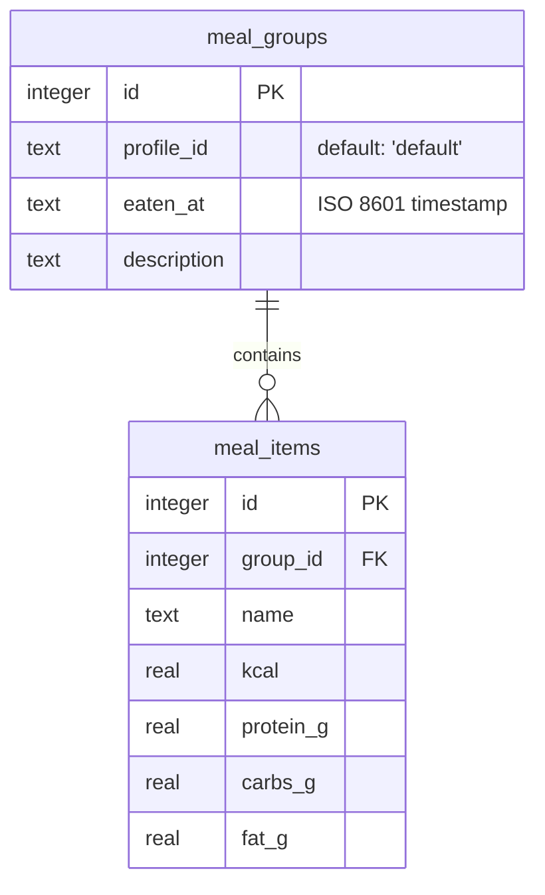

# Database (SQL persistence)

This document describes the SQL layer added to the backend (`server/db/`,
`server/routes/meals.js`). It exists alongside, not instead of, the
existing localStorage-based persistence used by the UI — see
**Limitations** below.

## Model

Two tables, linked by a foreign key, deliberately mirroring the same
"one meal = several items" shape that caused the `remove_last_meal`
bug fixed earlier today (see `docs/03_DECISION_LOG.md`, 2026-10-19):



A `meal_group` is one reported meal; its `meal_items` are the individual
foods in it. Deleting a group cascades to its items (`ON DELETE
CASCADE`), so removing a meal always removes it as a whole, not one
item at a time.

## Schema

`server/db/schema.sql` (idempotent — safe to run on every startup):

```sql
CREATE TABLE IF NOT EXISTS meal_groups (
  id INTEGER PRIMARY KEY AUTOINCREMENT,
  profile_id TEXT NOT NULL DEFAULT 'default',
  eaten_at TEXT NOT NULL,
  description TEXT
);

CREATE TABLE IF NOT EXISTS meal_items (
  id INTEGER PRIMARY KEY AUTOINCREMENT,
  group_id INTEGER NOT NULL REFERENCES meal_groups(id) ON DELETE CASCADE,
  name TEXT NOT NULL,
  kcal REAL NOT NULL,
  protein_g REAL NOT NULL,
  carbs_g REAL NOT NULL,
  fat_g REAL NOT NULL
);

CREATE INDEX IF NOT EXISTS idx_meal_groups_profile_date
  ON meal_groups (profile_id, eaten_at);
```

The index exists because every query filters by `profile_id` and a date
(or date range) on `eaten_at` together — today's totals, a range of
days — so SQLite can jump straight to the matching rows instead of
scanning the whole table.

## The 3 main queries, explained

**1. `totalsByDate` — sum everything eaten on one day**

```sql
SELECT
  SUM(mi.kcal) AS kcal,
  SUM(mi.protein_g) AS protein_g,
  SUM(mi.carbs_g) AS carbs_g,
  SUM(mi.fat_g) AS fat_g
FROM meal_groups mg
JOIN meal_items mi ON mi.group_id = mg.id
WHERE mg.profile_id = ? AND date(mg.eaten_at) = ?
GROUP BY date(mg.eaten_at)
```

- `JOIN meal_items mi ON mi.group_id = mg.id` — for every group, pull in
  its items; without this, we'd only have groups, no actual food values
  to add up.
- `WHERE mg.profile_id = ? AND date(mg.eaten_at) = ?` — keep only this
  profile's rows, and only the ones eaten on the given day. `date(...)`
  strips the time-of-day part off the stored timestamp, so `12:00` and
  `23:59` on the same day both match.
- `GROUP BY date(mg.eaten_at)` — tells SQLite "add these up per day."
  Since the `WHERE` already narrows it to one day, this always produces
  a single row here — it's written this way to match `totalsByRange`
  below, which needs the grouping for real.
- `SUM(...)` on each column — the actual addition, one sum per macro.
- The `?` placeholders are **parameters**, not string concatenation —
  the values are sent separately from the SQL text, so a malicious
  value (e.g. someone typing `' OR 1=1 --` as a date) can never change
  what the query does. That's what prevents SQL injection.

**2. `totalsByRange` — one totals row per day, across a date range**

```sql
SELECT
  date(mg.eaten_at) AS day,
  SUM(mi.kcal) AS kcal, SUM(mi.protein_g) AS protein_g,
  SUM(mi.carbs_g) AS carbs_g, SUM(mi.fat_g) AS fat_g
FROM meal_groups mg
JOIN meal_items mi ON mi.group_id = mg.id
WHERE mg.profile_id = ? AND date(mg.eaten_at) BETWEEN ? AND ?
GROUP BY date(mg.eaten_at)
ORDER BY day ASC
```

Same shape as above, but `WHERE ... BETWEEN ? AND ?` keeps several days
instead of one, and `GROUP BY date(mg.eaten_at)` now does real work:
instead of one combined number, SQLite buckets the matching rows by day
first, then sums each bucket separately — so the result is a list, one
row per day that actually has data (days with nothing logged don't
appear at all).

**3. `removeLastGroup` — find then delete the most recent meal**

```sql
SELECT id FROM meal_groups WHERE profile_id = ?
ORDER BY eaten_at DESC, id DESC LIMIT 1;

DELETE FROM meal_groups WHERE id = ?;
```

Two statements: first find the id of the most recently eaten group for
this profile (`ORDER BY eaten_at DESC` puts the latest first; `id DESC`
as a tiebreaker if two meals share the exact same timestamp), then
delete it by that id. The `DELETE` only removes the one row in
`meal_groups` — but because the foreign key was declared with `ON
DELETE CASCADE` (and `PRAGMA foreign_keys = ON` is set on every
connection), SQLite automatically deletes that group's `meal_items`
rows too. This is the same "remove the whole meal, not one item" fix
applied today to the UI's own correction logic, now expressed at the
database level instead of in application code.

## API (Fase A)

See the README's **API** section for the full list of endpoints with
`curl` examples.

## Limitations

- **The UI does not talk to this API yet.** The frontend still reads
  and writes exclusively to `localStorage` (`profileStorage.ts`,
  `sessionStorage.ts`) — this database is a separate, parallel
  persistence layer with its own REST endpoints, not yet wired into
  `ChatScreen.tsx`. That integration (a one-way mirror: localStorage
  stays the source of truth, the API gets a best-effort copy) is
  planned as a separate phase.
- No migrations tool — `schema.sql` is plain, idempotent DDL, fine for
  a single evolving schema at this stage but would need a real
  migration strategy (e.g. numbered `.sql` files) before this schema
  changes shape in production.
- No authentication — `profile_id` is a plain client-supplied header
  (`X-Profile-Id`), not a verified identity.
